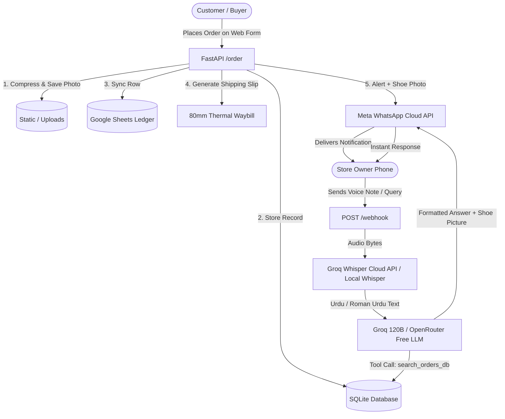

# 👟 ThriftPulse

> **The Intelligent Operating System for Thrift Sneaker Stores**  
> *Automated Order Intake, Google Sheets Sync, 80mm Thermal Waybills, and Multilingual WhatsApp AI Assistant.*

---

## ⚡ Overview

**ThriftPulse** streamlines the chaotic workflow of pre-loved sneaker & thrift fashion businesses. Instead of manually copying phone numbers, chasing delivery addresses, and searching through hundreds of shoe photos while driving, ThriftPulse automates the entire lifecycle:

1. **Self-Service Order Intake (`/order`):** Share a single link with buyers on WhatsApp, Instagram, or Facebook. The form auto-compresses shoe screenshots in the customer's browser down to ~300KB before uploading.
2. **Instant Owner WhatsApp Alerts:** Upon submission, the store owner receives an immediate WhatsApp alert containing full customer details, COD amount, shipping address, and the **attached shoe photo**.
3. **80mm Thermal Waybill Generator:** Instant, printer-ready shipping labels formatted for portable Bluetooth receipt printers or riders.
4. **WhatsApp AI Assistant (Text & Voice Notes):** Store owners can text or send voice notes in **English, Urdu, or Roman Urdu** (*"Ali k joote ki details do"*, *"0312... kiska order hai"*). The AI queries the database via tool-calling and replies in seconds.
5. **100% Free AI Infrastructure:** Built-in zero-cost stack using **Groq** (`whisper-large-v3-turbo` + `openai/gpt-oss-120b`), **OpenRouter** (`openrouter/free`), and offline **faster-whisper** fallback.

---

## 🏗️ Architecture



---

## ✨ Features

* **Client-Side Image Compression:** Reduces 10MB phone camera shots to lightweight ~300KB JPEG in milliseconds without server CPU overhead.
* **Multilingual AI Assistant:** Natively understands English, Nastaliq Urdu, and everyday Roman Urdu slang (*"kiska order pending hai"*, *"Ali ka phone number bhejna"*).
* **Dual Speech-to-Text Pipeline:**
  * **Groq Cloud Whisper:** Ultra-fast ~300ms transcription for free.
  * **Local `faster-whisper`:** Automatic offline fallback running directly on your CPU/GPU without needing any API key.
* **Thermal Receipt Printing:** Specially styled CSS for 80mm roll receipt printers with barcode, COD tags, and one-tap printing.
* **Live Google Sheets Mirroring:** Automatically appends new orders to your cloud spreadsheet in real-time.
* **Serverless Ready:** Built with native Vercel serverless support (`api/index.py` and `vercel.json`).

---

## 📁 Project Structure

```text
thriftpulse/
├── api/
│   └── index.py               # Vercel serverless entrypoint
├── app/
│   ├── api/
│   │   └── orders.py          # /order, /api/orders, /invoice endpoints
│   ├── connectors/
│   │   ├── google_sheets.py   # Live Google Sheets sync
│   │   └── whatsapp_client.py # Meta WhatsApp Cloud API wrapper
│   ├── core/
│   │   ├── config.py          # Pydantic Settings with Vercel auto-detection
│   │   ├── database.py        # SQLite async engine & order search
│   │   └── logging.py         # Structured logging (structlog)
│   ├── models/
│   │   └── order.py           # Pydantic Order schemas
│   ├── services/
│   │   ├── ai_assistant.py    # Multi-provider LLM (Groq / OpenRouter / OpenAI)
│   │   ├── invoice_generator.py# 80mm thermal shipping slip generator
│   │   └── voice.py           # Multi-engine Whisper (Groq Free / faster-whisper)
│   ├── static/
│   │   ├── invoices/          # Generated HTML waybills
│   │   └── uploads/shoes/     # Customer-uploaded shoe photos
│   ├── templates/
│   │   └── order_form.html    # Premium glassmorphic order web page
│   └── webhook/
│       └── routes.py          # Meta WhatsApp webhook router
├── docs/                      # Architecture, user guides, and edge-case specs
├── .env.example               # Sanitized environment template
├── .gitignore                 # GitHub ignore rules (protects keys and DB)
├── main.py                    # ASGI application & local server runner
├── pyproject.toml             # Project metadata & package configuration
├── requirements.txt           # Lightweight cloud-ready dependencies
├── test_openrouter_whisper.py # Automated AI & voice verification test
├── test_runner.py             # End-to-end integration test suite
└── vercel.json                # Vercel serverless routing configuration
```

---

## 🚀 Quickstart (Local Development)

### 1. Clone & Setup Environment
```bash
git clone https://github.com/your-username/thriftpulse.git
cd thriftpulse

python -m venv .venv
# Windows
.venv\Scripts\activate
# Linux / macOS
source .venv/bin/activate

pip install -r requirements.txt
```

*(Optional: For local offline Whisper without Groq cloud, install `pip install faster-whisper`)*

### 2. Configure Environment Variables
Copy the template to `.env`:
```bash
cp .env.example .env
```
Fill in:
- `GROQ_API_KEY`: Get a 100% free key from [console.groq.com](https://console.groq.com) (no credit card required).
- `WHATSAPP_ACCESS_TOKEN`, `WHATSAPP_PHONE_NUMBER_ID`, `WHATSAPP_VERIFY_TOKEN`: From [Meta for Developers](https://developers.facebook.com).
- `OWNER_PHONE_NUMBER`: Your phone number with country code (e.g. `923129214688`).

### 3. Run Diagnostics & Tests
```bash
python test_openrouter_whisper.py
python test_runner.py
```

### 4. Start the Application
```bash
python main.py
```
Open your browser to:
- Public Order Form: `http://localhost:8000/order`
- Swagger API Docs: `http://localhost:8000/docs`

---

## ☁️ Deploying to Vercel

ThriftPulse is pre-configured for **one-click Vercel Serverless deployment**:

1. **Push to GitHub**:
   ```bash
   git init
   git add .
   git commit -m "Initial commit of ThriftPulse"
   git remote add origin https://github.com/your-username/thriftpulse.git
   git push -u origin main
   ```

2. **Import into Vercel**:
   - Go to [vercel.com](https://vercel.com) and click **"Add New Project"**.
   - Select your `thriftpulse` repository.
   - Vercel will automatically detect `requirements.txt` and `api/index.py`.

3. **Set Environment Variables on Vercel Dashboard**:
   Add the following in **Settings $\rightarrow$ Environment Variables**:
   * `GROQ_API_KEY`: `gsk_...`
   * `WHATSAPP_ACCESS_TOKEN`: `EAA...`
   * `WHATSAPP_PHONE_NUMBER_ID`: `...`
   * `WHATSAPP_VERIFY_TOKEN`: `...`
   * `OWNER_PHONE_NUMBER`: `923...`
   * `BASE_URL`: `https://your-project.vercel.app`

4. **Setup Meta WhatsApp Webhook**:
   - In Meta App Dashboard $\rightarrow$ WhatsApp $\rightarrow$ Configuration:
   - **Callback URL:** `https://your-project.vercel.app/webhook`
   - **Verify Token:** The secret token you set in `WHATSAPP_VERIFY_TOKEN`.
   - Subscribe to the `messages` webhook field.

---

## ⚙️ Environment Variables Reference

| Variable | Description | Required? | Default / Example |
| :--- | :--- | :---: | :--- |
| `GROQ_API_KEY` | Free key for Whisper & 120B LLM | **Yes** | `gsk_...` |
| `LLM_PROVIDER` | LLM routing mode (`auto`, `groq`, `openrouter`) | Optional | `auto` |
| `GROQ_MODEL` | Groq chat model ID | Optional | `openai/gpt-oss-120b` |
| `GROQ_WHISPER_MODEL` | Speech-to-text model ID | Optional | `whisper-large-v3-turbo` |
| `WHATSAPP_ACCESS_TOKEN` | Meta System User Access Token | **Yes** | `EAA...` |
| `WHATSAPP_PHONE_NUMBER_ID` | WhatsApp Business Phone ID | **Yes** | `1278129008726094` |
| `WHATSAPP_VERIFY_TOKEN` | Secret handshake token for Meta | **Yes** | `thrift_bot_verify` |
| `OWNER_PHONE_NUMBER` | Store owner WhatsApp number | **Yes** | `923129214688` |
| `BASE_URL` | Public domain for images & invoices | **Yes** | `https://your-domain.com` |
| `DATABASE_URL` | SQLite or external Postgres connection | Optional | `sqlite+aiosqlite:///thrift_orders.db` |
| `SPREADSHEET_ID` | Google Sheet ID for live syncing | Optional | `1vwfqpurRYzFZo...` |

---

## 🛡️ License

Distributed under the **MIT License**. See `LICENSE` for details.
